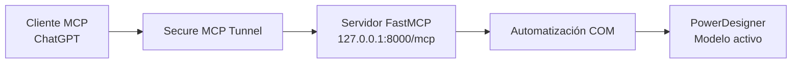

# PowerDesigner MCP

**Consultá y automatizá modelos de SAP/Sybase PowerDesigner desde asistentes de IA mediante Model Context Protocol (MCP).**


PowerDesigner MCP es un servidor local en Python que utiliza la automatización **COM** de PowerDesigner. Permite a un cliente MCP consultar la estructura de un modelo, leer propiedades y ejecutar determinadas modificaciones controladas sin depender de una interfaz gráfica para cada acción.

El proyecto se desarrolló y probó en **Windows 11, PowerDesigner 16.5.0.3982 y Python 3.12**. Está en desarrollo: **no es todavía una versión estable ni se ha validado su instalación en otros equipos**.

> [!NOTE]
> Este es un proyecto independiente, no oficial y sin afiliación con SAP ni OpenAI. Requiere una instalación y licencia de PowerDesigner aportadas por el usuario. No distribuye PowerDesigner ni sus componentes propietarios.

**[Instalación detallada](docs/GUIA_PASO_A_PASO.md)** · **[Solución de problemas](docs/SOLUCION_DE_PROBLEMAS.md)** · **[Historial de cambios](CHANGELOG.md)** · **[Reportar un problema](https://github.com/d4vdxh1/powerdesigner-mcp/issues)**

---

## Qué permite hacer

- **Explorar modelos:** conocer el modelo activo, navegar colecciones y consultar propiedades de objetos UML.
- **Trabajar con elementos:** crear actores y casos de uso, modificar propiedades permitidas y representar elementos existentes en diagramas.
- **Inspeccionar geometría:** obtener posiciones y dimensiones de símbolos, así como los puntos de dependencias en diagramas de clases.
- **Ajustar diagramas:** mover símbolos de paquetes, enderezar dependencias o insertar un codo en una flecha, con previsualización antes de aplicar cambios.
- **Controlar modificaciones:** operar en modo solo lectura por defecto; habilitar escritura únicamente para un archivo explícitamente autorizado.

### Herramientas MCP disponibles

| Herramienta | Operación | Tipo |
| --- | --- | --- |
| `consultar_modelo_activo` | Consulta versión, modelo y archivo abierto | Lectura |
| `listar_coleccion` | Enumera objetos de una colección y devuelve sus rutas | Lectura |
| `leer_propiedades` | Consulta propiedades y referencias de objetos | Lectura |
| `inspeccionar_diagrama` | Inspecciona posiciones, dimensiones y puntos de dependencias | Lectura |
| `editar_propiedad` | Edita `Name`, `Code`, `Comment` o `Description` | Escritura |
| `crear_objeto` | Crea actores o casos de uso | Escritura |
| `mostrar_en_diagrama` | Adjunta un objeto existente a un diagrama | Escritura |
| `mover_paquetes` | Previsualiza o mueve símbolos de paquetes | Escritura controlada |
| `enderezar_flechas` | Previsualiza o elimina puntos intermedios de dependencias | Escritura controlada |
| `insertar_codo_flecha` | Previsualiza o agrega un punto intermedio | Escritura controlada |
| `guardar_modelo` | Guarda el modelo activo | Escritura |

Las herramientas geométricas se limitan a **diagramas de clases**. Las tres operaciones geométricas aplican cambios en memoria solo con `confirmar=True`; después es necesario guardar el modelo. No se incluye un organizador automático integral de diagramas.

## Arquitectura



Actualmente, la instalación documentada utiliza **OpenAI Secure MCP Tunnel** para conectar ChatGPT con el servidor local. El transporte HTTP del servidor es MCP; la compatibilidad con **Claude Code, Cursor y Codex** forma parte de la hoja de ruta y **no se declara todavía verificada**.

## Requisitos

| Componente | Requisito |
| --- | --- |
| Sistema operativo | Windows; pruebas realizadas en Windows 11 |
| Aplicación | PowerDesigner instalado y accesible por COM; pruebas con 16.5.0.3982 |
| Python | Python 3.12 con lanzador `py` |
| Dependencias | `mcp` y `pywin32`, instaladas desde `requirements.txt` |
| ChatGPT mediante túnel | Acceso al complemento MCP, un túnel autorizado de OpenAI Platform y `tunnel-client.exe` |

La aplicación PowerDesigner debe estar abierta con un modelo activo. El servidor utiliza la sesión COM del usuario de Windows.

## Inicio rápido

### 1. Preparar el entorno

Cloná el repositorio y ejecutá el instalador desde PowerShell:

```powershell
git clone https://github.com/d4vdxh1/powerdesigner-mcp.git
cd powerdesigner-mcp
powershell.exe -NoProfile -ExecutionPolicy Bypass -File .\instalar.ps1
```

El instalador crea el entorno virtual `.venv`, instala dependencias y genera `config.local.json` a partir del ejemplo si aún no existe.

### 2. Configurar la conexión

Para utilizar el **inicio con túnel**, descargá el cliente oficial de OpenAI y colocá `tunnel-client.exe` en el directorio del proyecto. Creá o seleccioná el túnel en [OpenAI Platform](https://platform.openai.com/settings/organization/tunnels).

Configuración mínima de `config.local.json`:

```json
{
  "tunnel_id": "tunnel_TU_IDENTIFICADOR",
  "write_model": ""
}
```

`write_model` vacío mantiene la escritura **deshabilitada**. No guardes claves de API en el archivo de configuración ni lo subas a GitHub. La [guía paso a paso](docs/GUIA_PASO_A_PASO.md) explica los permisos y la configuración del túnel.

### 3. Ejecutar

Con PowerDesigner abierto y un modelo guardado, iniciá el servidor y el túnel:

```powershell
.\Iniciar-MCP.cmd
```

El iniciador comprueba la configuración y **rechaza el arranque si el puerto 8000 ya está ocupado**, para evitar reutilizar inadvertidamente otro servidor. La clave del túnel, cuando sea necesaria, se almacena cifrada para el usuario de Windows.

También es posible iniciar **solo el servidor local**, sin el túnel, para pruebas con un cliente MCP compatible:

```powershell
.\.venv\Scripts\python.exe servidor.py
```

Este inicio directo mantiene la escritura bloqueada si no está definida la variable de autorización. El endpoint MCP local es `http://127.0.0.1:8000/mcp`; abrir esa URL en un navegador **no equivale** a probar una solicitud MCP.

### 4. Probar primero en lectura

En el cliente conectado, comenzá con:

> Consultá el modelo activo de PowerDesigner. No realices ninguna modificación.

Después podés solicitar que liste los diagramas u objetos disponibles. **Usá una copia de un modelo para las primeras pruebas de escritura.**

## Seguridad y respaldo

La seguridad de esta versión parte de cuatro reglas:

1. **Solo lectura por defecto.** Las herramientas mutadoras, incluido el guardado, rechazan solicitudes cuando no hay un archivo autorizado.
2. **Autorización por archivo.** Para permitir escritura, indicá en `config.local.json` la ruta absoluta existente del único modelo autorizado mediante `write_model` y reiniciá el iniciador. El modelo activo debe coincidir con esa ruta.
3. **Respaldo antes de editar.** En la primera modificación de un archivo durante cada ejecución, el servidor copia su versión guardada en disco. Ese respaldo **no incluye cambios previos sin guardar**.
4. **Acceso restringido a localhost.** FastMCP escucha en `127.0.0.1:8000`. Esto **no es autenticación de clientes**; no expongas el endpoint directamente en una red pública.

> [!CAUTION]
> Las operaciones sobre PowerDesigner pueden fallar parcialmente y **no existe rollback transaccional general**. Comprobá los resultados en PowerDesigner y conservá respaldos independientes de tus modelos antes de autorizar modificaciones.

Nunca publiques `config.local.json`, `clave_tunel.xml`, claves de API, modelos `.oom`, copias de respaldo ni ejecutables de terceros.

## Pruebas y estado del proyecto

**Validado en el entorno de desarrollo:**

- Registro de las **11 herramientas** MCP y pruebas automatizadas de autorización.
- Comunicación HTTP/MCP: inicialización, listado de herramientas y rechazo de guardado no autorizado.
- Conexión COM con PowerDesigner 16.5.
- Inspección de un diagrama de prueba; movimiento y restauración de un paquete y de puntos de una dependencia.
- Guardado, reapertura y verificación de geometría restaurada sobre una **copia de prueba**.
- Comprobaciones del iniciador PowerShell y GitHub Actions.

Para ejecutar las pruebas automatizadas:

```powershell
.\.venv\Scripts\python.exe -m unittest discover -s tests -p "test_*.py" -v
```

**Pendiente:** comprobar una instalación limpia en otra computadora, ampliar la cobertura ante errores parciales y validar el arranque completo del túnel con la versión actualizada. Estas pruebas locales **no constituyen una auditoría integral de seguridad**.

## Hoja de ruta

- [x] Consolidar 11 herramientas MCP y pruebas iniciales de seguridad.
- [x] Integrar el código validado en `main` mediante [PR #1](https://github.com/d4vdxh1/powerdesigner-mcp/pull/1).
- [ ] Mejorar instalación, documentación y distribución.
- [x] Preparar la **skill v0.1 de PowerDesigner** con [SKILL.md](skills/powerdesigner/SKILL.md), [procedimientos](skills/powerdesigner/references/workflows.md) e [instalación](skills/powerdesigner/references/setup.md). Su uso con clientes externos y su publicación siguen pendientes de validación.
- [ ] Validar la conexión con Claude Code, Cursor y Codex.
- [ ] Preparar demostración, empaquetado y eventual publicación en **Agensi**.

Las capacidades futuras no deben confundirse con funcionalidades disponibles hoy.

## Skill para agentes (versión preliminar)

La carpeta [`skills/powerdesigner/`](skills/powerdesigner/SKILL.md) contiene instrucciones que permiten a un agente conectado al **servidor MCP instalado por separado** explorar modelos y proponer cambios con confirmación previa. **Instalar la skill no instala PowerDesigner ni conecta automáticamente un cliente MCP.** Esta integración todavía no se ha probado en Claude Code, Cursor o Codex ni publicado en Agensi. Consultá la [matriz de compatibilidad](skills/powerdesigner/references/compatibility.md), la [sesión ilustrativa](skills/powerdesigner/examples/example-session.md) y la [lista de preparación para Agensi](docs/AGENSI_PUBLICACION.md).

## Documentación y colaboración

- [Guía completa de instalación y conexión](docs/GUIA_PASO_A_PASO.md)
- [Solución de problemas](docs/SOLUCION_DE_PROBLEMAS.md)
- [Publicación y precauciones al compartir el repositorio](docs/PUBLICAR_EN_GITHUB.md)
- [Historial de cambios](CHANGELOG.md)

Si encontrás un problema reproducible, abrí un [issue](https://github.com/d4vdxh1/powerdesigner-mcp/issues) e indicá el comportamiento observado, versión de Windows/PowerDesigner y pasos para reproducirlo, **sin incluir credenciales ni datos de modelos privados**.

### Licencia

**Todavía no se ha elegido una licencia para el código propio de este repositorio.** La visibilidad pública del repositorio no implica autorización automática para redistribuirlo o comercializarlo. Antes de publicar paquetes para terceros se debe definir esa licencia y revisar las de las dependencias. PowerDesigner y otros componentes externos mantienen sus respectivas condiciones.

---

<sub>Proyecto independiente desarrollado para explorar la automatización de modelos de PowerDesigner mediante Model Context Protocol. No distribuye software propietario ni credenciales.</sub>
